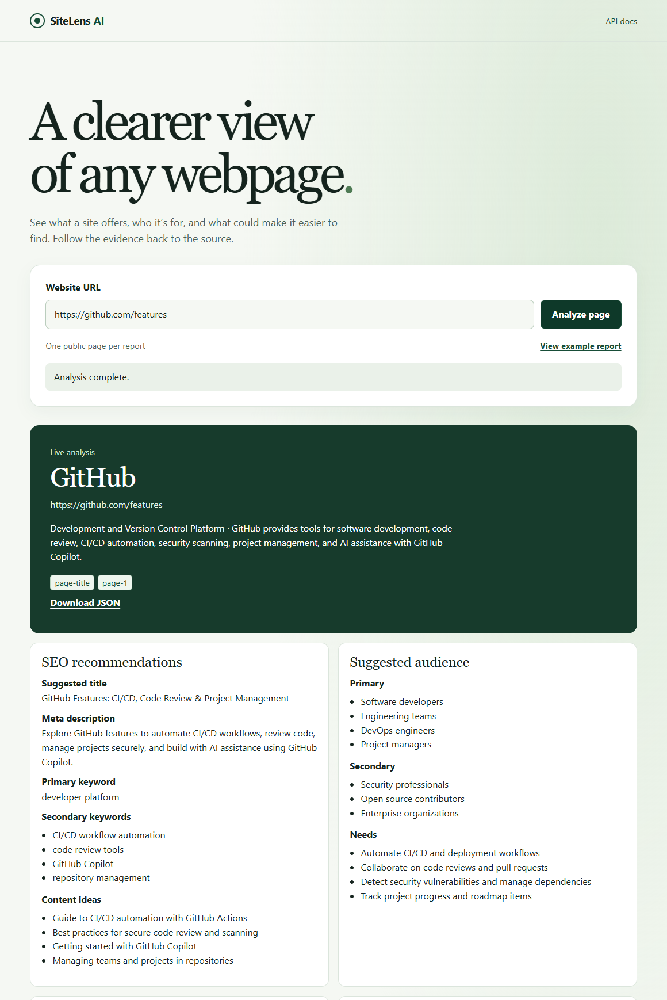

# SiteLens AI

SiteLens turns a public webpage into a business and SEO report with clickable evidence. Paste a URL to see what the page offers, who it might serve, and how it could be easier to find. FastAPI serves the browser interface and API, and Gemini handles embeddings and report generation in hosted mode.

**[Try the live demo](https://sitelens-ai.onrender.com/)** · [Recorded JSON example](examples/response.json)

Paste a public URL to run a live analysis, or select **View example report** to open a saved result without using the daily quota.

## Example report

A live SiteLens analysis of [GitHub Features](https://github.com/features), showing the source-linked summary, SEO recommendations, and suggested audience.



## Run SiteLens with Gemini

Install Python 3.11. From the project directory in PowerShell, create the virtual environment and install the dependencies:

```powershell
py -3.11 -m venv .venv
.\.venv\Scripts\python.exe -m pip install -r requirements.txt
```

Get a free-tier key in [Google AI Studio](https://aistudio.google.com/apikey). Click **Copy** on the key, then run these commands in the same PowerShell terminal. The clipboard command sets the key for this terminal without displaying it.

```powershell
$env:SITELENS_PROVIDER = 'gemini'
$env:GEMINI_API_KEY = (Get-Clipboard -Raw).Trim()
.\.venv\Scripts\python.exe -m uvicorn app.main:app --host 127.0.0.1 --port 4000
```

Open [SiteLens](http://127.0.0.1:4000/) and try `https://github.com/features`. Click a citation to see its source passage, or download the full report as JSON. To view only the recorded example, run the Uvicorn command by itself and click **View example report**.

Gemini mode defaults to `gemini-embedding-2` and `gemini-3.5-flash-lite`. Set `SITELENS_GEMINI_EMBED_MODEL` or `SITELENS_GEMINI_CHAT_MODEL` to change them. Gemini receives the extracted public webpage text used for retrieval and generation. [Google's free-tier data terms](https://aistudio.google.com/docs/pricing)

## Deploy a free Render demo

Visitors open the hosted URL and paste a website. The service owner configures the Gemini key and quota store once in Render.

1. Create a **Free Redis** database in the [Upstash console](https://console.upstash.com/). Copy its **HTTPS REST URL** and **read/write REST token**.
2. In the [Render dashboard](https://dashboard.render.com/), choose **New → Blueprint**, connect this repository, and select `main`. The [Blueprint](render.yaml) selects a free Python service and configures the build, start command, and health check.
3. Enter `GEMINI_API_KEY`, `UPSTASH_REDIS_REST_URL`, and `UPSTASH_REDIS_REST_TOKEN` in Render's private settings. Deploy the Blueprint and verify the recorded example, a live analysis, and rejection of private URLs. Restrict fetch-worker egress for a public deployment.

The Blueprint sets a shared cap of **10 live analyses per UTC day**. A Redis counter keeps the count across app restarts. SiteLens reserves a slot after extracting the page and before calling the model. Failed model calls still consume their reserved slots. At the cap, the API returns `429` with `Retry-After`. If Redis is unavailable, it returns `503`. The recorded example stays available in both cases.

Local runs skip the shared cap when `SITELENS_DAILY_ANALYSIS_LIMIT` is unset. To try the cap locally, set a positive limit and both Upstash environment variables.

## What a report contains

The report includes a brand profile, five platform-specific search suggestions, SEO recommendations, evidenced services, suggested audiences, and competitor comparisons where reviewed sources exist. The recorded FastAPI report includes three curated alternatives. Other pages report insufficient competitor evidence. Search and SEO recommendations are suggestions.

The API exposes both `website`, the submitted URL, and `source_url`, the page actually read after redirects. View the [interactive API docs](http://127.0.0.1:4000/docs) while the server is running, or request a report from a second terminal:

```powershell
Invoke-RestMethod -Uri 'http://127.0.0.1:4000/link-analysis' -Method Post -ContentType 'application/json' -Body '{"url":"https://github.com/features"}' | ConvertTo-Json -Depth 12
```

## Code walkthrough

| Module | What happens |
| --- | --- |
| [`main.py`](app/main.py) | FastAPI receives and validates the request, calls the pipeline, and translates failures into HTTP status codes. |
| [`website.py`](app/website.py) | Checks public destinations and redirects, fetches bounded HTML, removes page boilerplate, and assigns IDs to text passages. |
| [`ai.py`](app/ai.py) | Ranks passages by cosine similarity, validates generated reports, and checks citations and quotes. It also includes the local Ollama adapter. |
| [`gemini.py`](app/gemini.py) | Uses Google's hosted embedding and structured generation endpoints while reusing the same retrieval and evidence checks. |
| [`quota.py`](app/quota.py) | Reserves a live analysis in a shared daily counter before the model is called. |
| [`schemas.py`](app/schemas.py) | Defines the public response and model output. The model fills five named query slots. Python maps those slots to the API's platform labels. |
| [`competitors.py`](app/competitors.py) | Uses reviewed first-party documentation to compare Django, Flask, and Litestar as alternatives to FastAPI. |
| [`web/`](web/) | Browser interface for submitting a URL, opening evidence, showing a recorded report, and downloading the JSON. |

See the [worked learning guide](docs/walkthrough.md) and the [model evaluation notes](docs/model-comparison.md).

## Tests

```powershell
.\.venv\Scripts\python.exe -m pytest -q
```

The automated suite uses fixture HTML, fake network responses, and simulated model replies. It checks redirect validation, IP pinning, extraction, ranking, citations, report structure, provider errors, and quota enforcement. It runs without model credentials or outbound network access.

## Optional local mode with Ollama

For local model inference, start Ollama, then run:

```powershell
ollama pull all-minilm
ollama pull llama3.1
$env:SITELENS_PROVIDER = 'ollama'
.\.venv\Scripts\python.exe -m uvicorn app.main:app --host 127.0.0.1 --port 4000
```

Ollama runs on port 11434. Set `SITELENS_CHAT_MODEL` and `SITELENS_EMBED_MODEL` to use different local models.

## Scope

SiteLens analyzes one readable page per request. It checks every HTTP or HTTPS redirect, rejects private destinations, limits downloads and decoded HTML to 1 MB, and follows up to four redirects. Sites that require a login, block automated requests, or render their main content with JavaScript may be unavailable. Citations let readers review the evidence behind claims. Passages and vectors are kept in memory for the duration of the request.
